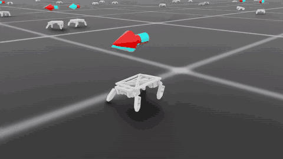
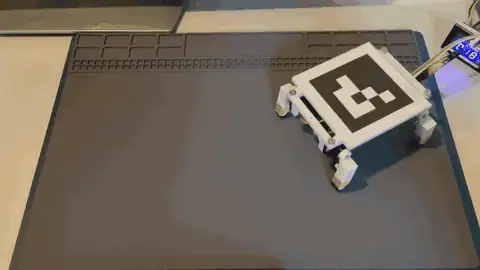
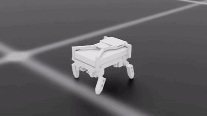
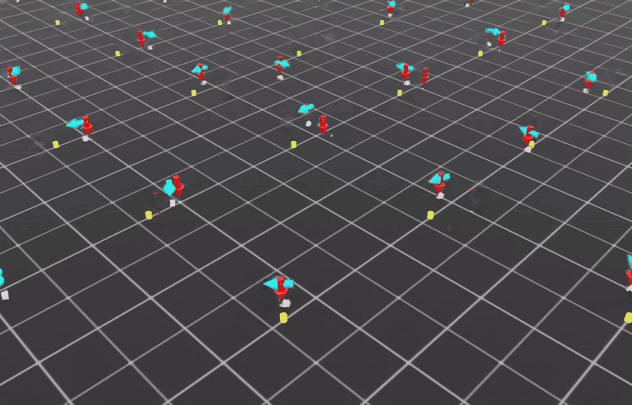
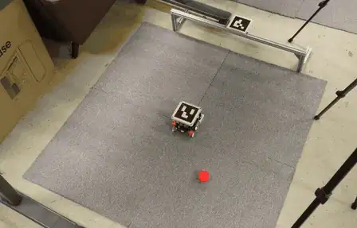
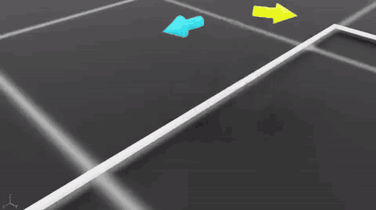
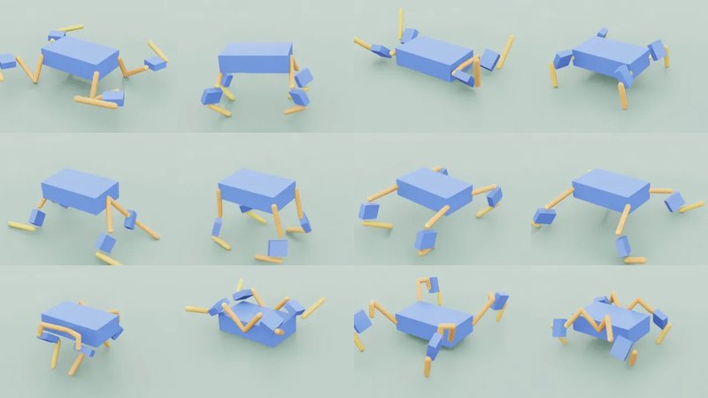
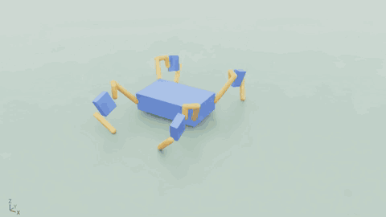
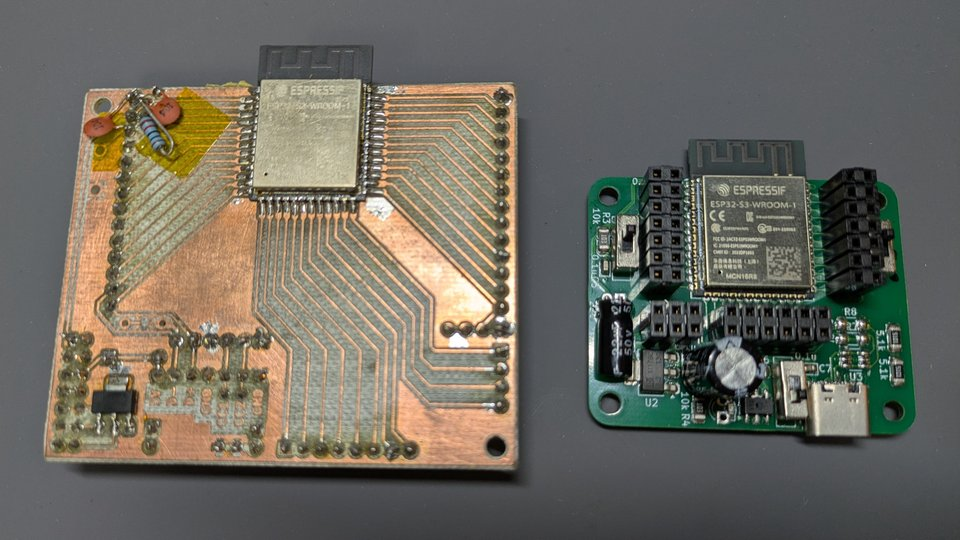

<h1 align="center">Hi, I'm tantakn</h1>

  設計・シミュレーション・強化学習・実機製作をつなげて、小さなロボットを動かしています。 
  <b>Robotics</b> ・ <b>Reinforcement Learning</b> ・ <b>Sim2Real</b> ・ <b>Computer Vision</b>

## 👤 About Me

- 工学系夜間大学 3年
- 2026年2月から、エンジニアのアルバイトとしてソフトウェアを担当
- いま取り組んでいること：ロボット形状の自動設計、小型四足歩行ロボットやサッカーロボットなどの Sim2Real

## 💼 Work

**画像検査装置のソフトウェア**（エンジニアのアルバイト・2026年2月〜）

- キーポイント数を独自に設定した YOLO-pose モデルを追加学習し、Raspberry Pi AI Kit（エッジAI）で動作
- 検査装置プロジェクトのソフトウェア全体を実装

## 🚀 Projects

### 🦿 手のひらサイズの四足歩行ロボット

#### V1 (2025)

- Fusion で設計 → 3Dプリント・サーボ×4で製作 → Isaac Lab で学習 → 実機で歩行・方向修正に成功
- 姿勢推定は ArUco + PnP を利用し、ニューラルネットワークによるリアルタイムフィードバックで制御
- 実機は重量が軽くケーブルの影響を受けてしまうことが課題
- 学内のピクトラボ成果発表会で発表

#### V2 (2026〜)

- ESP32・IMU・バッテリーを搭載し、ESP32 での Edge AI によりスタンドアロンで動作するバージョン
- 重量増加による安定した歩行を目指す

`Isaac Lab` `OpenCV` `Fusion` `KiCad` `ESP32` `IMU` `Edge AI`

### ⚽ 強化学習ロボットサッカー

#### V1 (2025)

- Raspberry Pi Mouse を使ったロボットサッカーの授業で、ルールベースではなく強化学習で制御を作り、実機でゴールを決めることに成功
- 位置推定は ArUco + PnP を利用し、ニューラルネットワークによるリアルタイムフィードバックで制御

#### V2 (2026〜)

- 自己対戦による強化学習

`Isaac Lab` `OpenCV` `Fusion`

### 🧬 ロボット形状の自動設計 (2026〜)

- 本体・棒・サーボの組み合わせをランダムに生成し、進化的アルゴリズムで世代交代

`Isaac Lab` `USD` `Evolutionary Algorithm`

### 🧩 Other Projects

- **ESP32-S3 開発ボード**

    

    左：初期のボード（2024）　　右：最新のボード（2026）

    `KiCad` `ESP32-S3`
- **ロケット点火装置** — 制御 PC と ATmega328P を RS-485 で接続。展覧会で展示 `ATmega328P` `RS-485`
- USB PD 電源基板・IMU 基板・サーボ試験機などのハードウェアを設計・製作
- **囲碁AI**（[TantamaGo](https://github.com/tantakn/TantamaGo)）— [TamaGo](https://github.com/kobanium/TamaGo) をフォークし、PyTorch の学習部を改造。C++ と TensorRT で合法手生成と AlphaGo 系の木探索を実装 `PyTorch` `C++` `TensorRT`

## 🛠 Tech Stack

**Robotics / ML**

**Languages**

**Hardware / Embedded**

**Tools**

